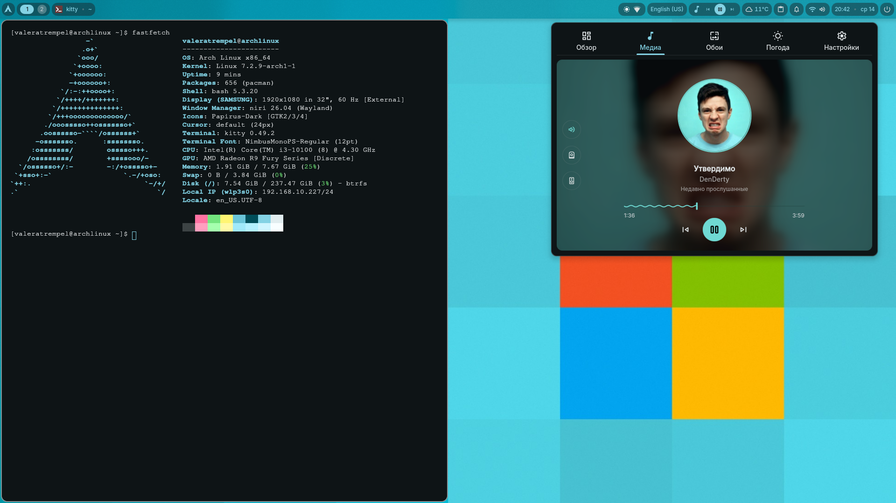
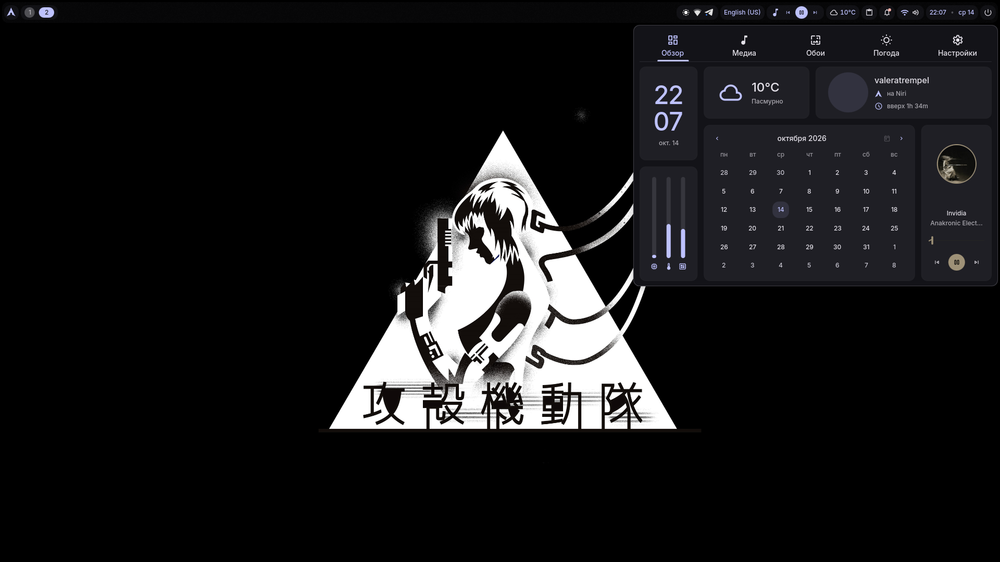
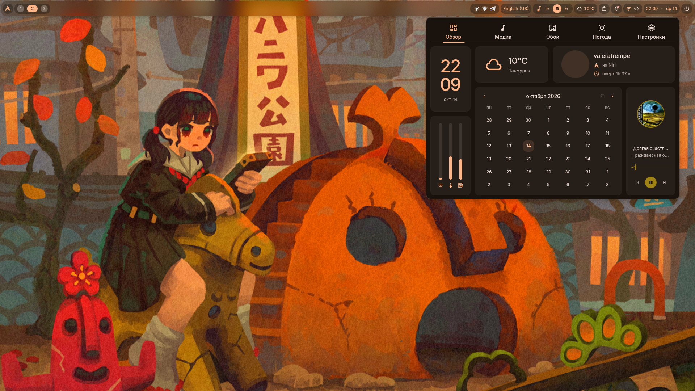
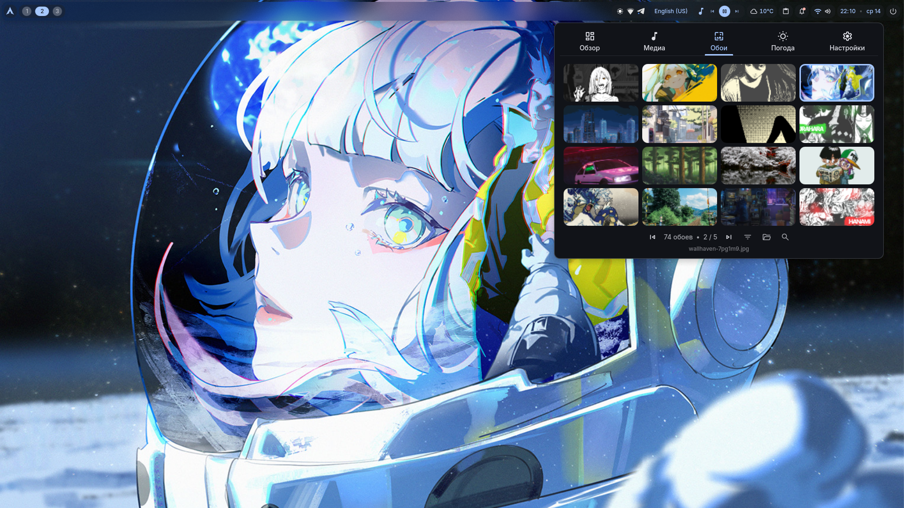

# Arch Setup

Персональная конфигурация Arch Linux для быстрого развёртывания рабочего окружения.

## Состав

- **Niri** — Wayland-композитор
- **DankMaterialShell (DMS)** — оболочка рабочего стола
- **greetd + DankGreeter** — графический экран входа
- **Пакеты** — базовая система, рабочий стол, приложения, оборудование и AUR

## Система автора

Пример вывода `fastfetch` на системе, для которой подготовлена конфигурация:

```text
                  -`                     valeratrempel@archlinux
                 .o+`                    -----------------------
                `ooo/                    OS: Arch Linux x86_64
               `+oooo:                   Kernel: Linux 7.2.9-arch1-1
              `+oooooo:                  Packages: 658 (pacman)
             -+oooooo+:                 Shell: bash 5.3.20
           `/:-:++oooo+:                Display (SAMSUNG): 1920x1080 in 32", 60 Hz [External]
          `/++++/+++++++:               Window Manager: niri 26.04 (Wayland)
         `/++++++++++++++:              Icons: Papirus-Dark [GTK2/3/4]
        `/+++ooooooooooooo/`            Cursor: default (24px)
       ./ooosssso++osssssso+`           Terminal: kitty 0.49.2
      .oossssso-````/ossssss+`          Terminal Font: NimbusMonoPS-Regular (12pt)
     -osssssso.      :ssssssso.         CPU: Intel(R) Core(TM) i3-10100 (8) @ 4.30 GHz
    :osssssss/        osssso+++.        GPU: AMD Radeon R9 Fury Series [Discrete]
   /ossssssss/        +ssssooo/-        Memory: 3.13 GiB / 7.67 GiB (41%)
 `/ossssso+/:-        -:/+osssso+-      Swap: 0 B / 3.84 GiB (0%)
`+sso+:-`                 `.-/+oso:     Disk (/): 8.07 GiB / 237.47 GiB (3%) - btrfs
`++:.                           `-/+/   Locale: en_US.UTF-8
.`                                 `/
```

## Галерея

<p align="center">
  <a href="screenshots/screenshot_2026-10-14_20-42-52.png"></a>
  <a href="screenshots/screenshot_2026-10-14_22-07-44.png"></a>
  <a href="screenshots/screenshot_2026-10-14_22-09-56.png"></a>
  <a href="screenshots/screenshot_2026-10-14_22-10-53.png"></a>
</p>

## Установка на свежий Arch Linux

### Требования

- Установленный и обновлённый Arch Linux с доступом в интернет.
- Обычный пользователь с настроенным `sudo`.
- Сеанс терминала от имени этого пользователя. Не запускай установщик через `sudo` и не входи для этого под `root`.

### Установка

1. Склонируй репозиторий:

   ```bash
   git clone https://github.com/valeratrempel/arch-setup.git ~/arch-setup
   cd ~/arch-setup
   ```

2. Запусти установщик:

   ```bash
   ./scripts/setup.sh
   ```

   Скрипт подготовит `yay`, установит пакеты из списков проекта, восстановит пользовательские конфиги Niri и DankMaterialShell, установит конфигурацию greetd и включит необходимые службы. При установке пакетов могут появляться запросы подтверждения.

3. После завершения проверь сообщения установщика и перезагрузи компьютер:

   ```bash
   sudo reboot
   ```

Установщик предназначен для свежей установки Arch Linux. Конфигурации и наборы пакетов рассчитаны на личное окружение автора; перед использованием на другом оборудовании учитывай отличия в драйверах, дисках и настройках системы.

## Обои

Обои можно подобрать на [Wallhaven](https://wallhaven.cc/).

## Структура репозитория

- `packages/` — списки пакетов
- `configs/home/.config/` — пользовательские настройки
- `configs/system/` — системные настройки
- `scripts/` — установка и восстановление

Секреты, токены, приватные ключи и пароли в репозитории не хранятся.
